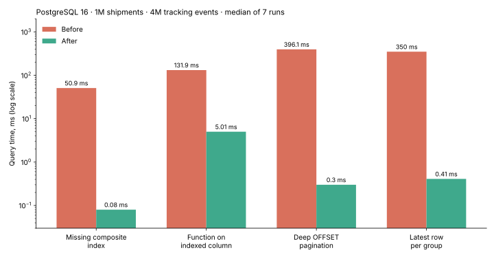

# PostgreSQL Query Optimization — Case Study

Four slow queries that show up in almost every real backend, measured before and after the fix
on a realistic dataset: **1,000,000 shipments and 4,000,000 tracking events** of a parcel
delivery service.



| Case | Problem | Fix | Before | After |
|---|---|---|---:|---:|
| [1](cases/01-missing-composite-index) | Dashboard filter + sort with no matching index | Composite index `(customer_id, status, created_at DESC)` | 50.9 ms | 0.08 ms |
| [2](cases/02-function-on-indexed-column) | `date_trunc()` on an indexed column disables the index | Rewrite as a half-open date range | 131.9 ms | 5.01 ms |
| [3](cases/03-deep-offset-pagination) | `OFFSET 500000` reads and throws away half a million rows | Keyset (seek) pagination | 396.1 ms | 0.30 ms |
| [4](cases/04-latest-row-per-group) | "Latest event per shipment" scans 4M rows | Index `(shipment_id, happened_at DESC)` + `LATERAL … LIMIT 1` | 350.0 ms | 0.41 ms |

Every fix returns **exactly the same rows** as the slow query — the benchmark checks this
automatically. Full numbers and buffer counts: [results/results.md](results/results.md).
Execution plans before and after each fix are in [results/](results).

> Measured with PostgreSQL 16, median of 7 runs after a warm-up run (data in cache).
> Absolute times depend on your hardware; run the benchmark yourself to get your own numbers.

## What each case teaches

1. **Index for the query, not for the column.** An index that matches both the `WHERE` and the
   `ORDER BY` lets PostgreSQL stop after the first 20 rows instead of sorting the whole table.
2. **Keep indexed columns "bare".** Wrapping a column in a function makes a plain index useless.
   A range condition on the raw column gives the same result and uses the index.
3. **OFFSET gets slower with every page.** Keyset pagination costs the same on page 1 and page 10,000.
4. **"Top-1 per group" needs the right index shape.** With `(group, sort_key DESC)` each group
   costs a single index lookup.

## Run it yourself

Requirements: Docker, Python 3 and the `psql` client.

```bash
docker compose up -d
export PGHOST=localhost PGPORT=5433 PGUSER=bench PGPASSWORD=bench PGDATABASE=shipping

psql -f sql/01_schema.sql
psql -f sql/02_seed.sql        # ~1 minute, ~500 MB
python bench/run.py            # writes results/results.md and the plans
```

The benchmark drops every index the cases create before each case (`bench/reset.sql`),
so each case is measured from the same starting point.

## Project structure

```
sql/        schema and deterministic seed data
cases/      one folder per case: slow.sql, fix.sql, fast.sql, README.md
bench/      benchmark runner and reset script
results/    measured times, before/after plans, chart
```

## About

I'm a backend developer working with C#/ASP.NET Core and PostgreSQL on production systems
for transport and logistics. If your queries, reports or API endpoints are slow, I can find
the cause and fix it — see my profile on Upwork.
